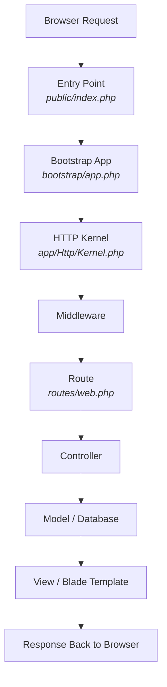

# Lab 5 - Laravel 101 & Blade Template Engine

---

# 🧑‍💻 **PART 1: Laravel 101 - Framework with Batteries Included 🔋🔋**

---

## 🎯 **Learning Objectives**

By the end of this lab, you should be able to:

1. Install Laravel 12 using Composer.
2. Configure environment and database connections.
3. Understand the Laravel 12 request lifecycle.
4. Use Artisan CLI to create models, controllers, and run migrations.
5. Explain the benefits of template engines
6. Serve the Laravel app locally and render data with Blade templates.

---

# 🧱 **PART 1: Hands-On Setup & Practice**

---

### **Task 1 — Install Laravel**

Create a new Laravel project called **thibitisha**:

```
$ cd /var/www/html
```

```bash
composer create-project laravel/laravel thibitisha
```

If you see an Xdebug warning such as:

```
Xdebug: [Step Debug] Could not connect to debugging client...
```

Silence it by editing your `/etc/php/8.3/fpm/conf.d/20-xdebug.ini`, prevent debugging from starting automatically:

```ini
xdebug.start_with_request=no
```

✅ **Outcome:** New Laravel 12 project created in `thibitisha/`. Open it in vscode

---

### **Task 2 — Install the Official Laravel VS Code Extension**

In VS Code → Extensions → search **Laravel** → Install the official **Laravel extension**.

✅ **Outcome:** You can view routes, run Artisan, and navigate models/controllers.

---

### **Task 3 — Understand the Laravel 12 Request Lifecycle**

(See full breakdown in **Part 2** below.)

✅ **Outcome:** Able to describe how a request flows through Laravel.

---

### **Task 4 — Configure the Database**

1. Create a MySQL database named `thibitisha`.
```bash
$ mysql -u root -p
```

```sql
create schema thibitisha;
```
2. Edit `.env`:

```env
DB_CONNECTION=mysql
DB_HOST=127.0.0.1
DB_PORT=3306
DB_DATABASE=thibitisha
DB_USERNAME=root
DB_PASSWORD=
```

✅ **Outcome:** Laravel connected successfully to your database.

---

### **Task 5 — Explore Artisan CLI**

List available commands:

```bash
php artisan list
```

✅ **Outcome:** You can identify common Artisan commands.

---

### **Task 6 — Run Default Migrations**

```bash
php artisan migrate
```

✅ **Outcome:** Default tables (`users`, `migrations`, etc.) created.

---

### **Task 7 — Create a Role Model**

Generate a model plus related files:

```bash
php artisan make:model Role -a
```

✅ **Outcome:** Model, migration, seeder, factory, and controller created for `Role`.

---

### **Task 8 — Update User Model & Add Foreign Key**

Edit the `users` migration:

```php
$table->foreignId('role_id')->constrained();
```

Re-run:

```bash
php artisan migrate:fresh --seed
```

✅ **Outcome:** Users table now includes `role_id` FK linked to roles.

---

### **Task 9 — Seed Dummy Data (for roles)**

Add sample roles/users in your seeders.
✅ **Outcome:** Database populated with test data.

---

### **Task 10 — Serve the Application**

Start Laravel’s development server:

```bash
php artisan serve
```

Visit: **[http://localhost:8000](http://localhost:8000)**

✅ **Outcome:** Laravel 12 welcome page visible.

---


# ⚙️ **PART 2: Laravel 12 Request Lifecycle (Reading - to be discussed later)**

---

## 🧭 **Overview Diagram**



---

## 🪜 **Step-by-Step Explanation**

### **1️⃣ Browser Request**

The user visits a page (e.g. `/roles`).
The browser sends a request to your Laravel app.

---

### **2️⃣ public/index.php — The Front Door**

All requests enter here.
It loads Composer, starts Laravel, and passes control to the Kernel.

---

### **3️⃣ bootstrap/app.php — Starting Laravel**

Initial setup: loads configurations, registers service providers, and prepares the app.

---

### **4️⃣ HTTP Kernel**

Located in `app/Http/Kernel.php`.
It decides which middleware and routes will handle the request.
🧠 Think of it as the **traffic controller**.

---

### **5️⃣ Middleware**

Middleware are filters that run before and after a request.
Examples: authentication, CSRF protection, trimming input.

---

### **6️⃣ Routing**

Laravel checks `routes/web.php` to match the request URI.

```php
Route::get('/roles', [RoleController::class, 'index']);
```

---

### **7️⃣ Controller**

The matched controller method runs your business logic:

```php
public function index() {
    $roles = Role::all();
    return view('roles.index', compact('roles'));
}
```

---

### **8️⃣ Model**

Models interact with the database.
`Role::all()` fetches data from the `roles` table.

---

### **9️⃣ View (Blade)**

Blade templates convert data into HTML.

```blade
@foreach($roles as $role)
  <p>{{ $role->name }}</p>
@endforeach
```

---

### **🔟 Response Back**

Laravel sends the final HTML (or JSON) back to the browser.
You see the rendered page.

---

## 🧠 **Quick Recap**

| Step | What Happens          | Example                           |
| ---- | --------------------- | --------------------------------- |
| 1    | Browser sends request | `/roles`                          |
| 2    | Enters Laravel        | `public/index.php`                |
| 3    | Laravel starts up     | `bootstrap/app.php`               |
| 4    | Kernel manages flow   | `app/Http/Kernel.php`             |
| 5    | Middleware runs       | `auth`, `VerifyCsrfToken`         |
| 6    | Route matched         | `/roles` → `RoleController@index` |
| 7    | Controller executes   | Fetch data                        |
| 8    | Model queries DB      | `Role::all()`                     |
| 9    | View renders          | Blade template                    |
| 10   | Response sent         | Page displayed                    |

---

# 💬 **Reflection Questions**

1. Why is Laravel called a “framework with batteries included”?
2. What role does `public/index.php` play in every request?
3. How do middleware help secure your application?
4. Why are migrations useful during development?
5. How does Blade simplify template inheritance?

---
# 🧑‍💻 **PART 3: Template Engines (Blade) 🔋🔋**

---

## 1️⃣ What Are Template Engines?

**Definition:**
A *template engine* is a tool that lets you write dynamic web pages by mixing HTML with special syntax that can display variables, include files, or repeat sections — without writing raw PHP, Python, or JS inside HTML.

**Purpose:**

* Avoids **code duplication**
* Makes **HTML cleaner and reusable**
* Separates **logic (backend)** from **presentation (frontend)**

---

## 2️⃣ Examples Across Web Technologies

| Language / Framework     | Common Template Engine                  | Syntax Example     |
| ------------------------ | --------------------------------------- | ------------------ |
| **PHP**                  | Blade (Laravel), Twig (Symfony), Smarty | `{{ $name }}`      |
| **Python**               | Jinja2 (Flask/Django)                   | `{{ user.name }}`  |
| **JavaScript (Node.js)** | EJS, Handlebars, Pug                    | `<%= username %>`  |
| **Ruby on Rails**        | ERB                                     | `<%= user.name %>` |
| **Java**                 | Thymeleaf, JSP                          | `${user.name}`     |

**Discussion Prompt:**

> “What problem do you see if every page had to repeat the same header, sidebar, and footer manually?”

→ Introduce the idea of **template inheritance**.


## Understanding Blade Templating {#understanding-blade}

### What is Blade?

Blade is Laravel's powerful templating engine that makes your views cleaner and more maintainable.

**Key Benefits:**
- **Reusability**: Write once, use everywhere
- **Inheritance**: Child views extend parent layouts
- **Clean Syntax**: Mix PHP and HTML elegantly
- **Performance**: Compiled to plain PHP and cached

### Core Blade Directives

| Directive | Purpose | Example |
|-----------|---------|---------|
| `@extends` | Inherit from a layout | `@extends('layouts.admin')` |
| `@section` | Define a content block | `@section('content')` |
| `@endsection` | Close a section | `@endsection` |
| `@yield` | Placeholder for content | `@yield('content')` |
| `@include` | Include another view | `@include('partials.alert')` |
| `@stack` | Push scripts/styles | `@stack('scripts')` |
| `@push` | Add to a stack | `@push('scripts')` |

### How It Works

```
┌─────────────────────────┐
│  layouts/admin.blade.php │  ← Master Template
│  (Header, Sidebar, Footer)│
└────────────┬────────────┘
             │
             │ @yield('content')
             │
             ↓
┌─────────────────────────┐
│  roles/index.blade.php   │  ← Child View
│  @extends('layouts.admin')│
│  @section('content')     │
└─────────────────────────┘
```

---

## Project Setup {#project-setup}

### Step 1: Create Directory Structure

```bash
# In your Laravel project root
mkdir -p resources/views/layouts
mkdir -p resources/views/layouts/partials
mkdir -p resources/views/roles
mkdir -p public/adminlte
```

### Step 2: Copy AdminLTE Assets

Download AdminLTE v4 from: https://github.com/ColorlibHQ/AdminLTE/releases

```bash
# Copy the dist folder contents to your public directory
public/
├── adminlte/
    ├── css/
        └── adminlte.css
    │   └── ....
    ├── js/
    │   └── adminlte.js
        └── ....
    ├── assets/
        └── img/
```

**Note**: In production, you'd typically use Laravel Mix/Vite, but since we are learning we are going to do things manually

---

## Creating the Master Layout {#master-layout}

### File: `resources/views/layouts/admin.blade.php`

This is your master template. Every page will extend this layout.

```blade
<!doctype html>
<html lang="en">
  <!--begin::Head-->
  <head>
    <meta http-equiv="Content-Type" content="text/html; charset=utf-8" />
    <title>@yield('title', 'Thibitisha | Dashboard')</title>
    
    <!--begin::Accessibility Meta Tags-->
    <meta name="viewport" content="width=device-width, initial-scale=1.0, user-scalable=yes" />
    <meta name="color-scheme" content="light dark" />
    <meta name="theme-color" content="#007bff" media="(prefers-color-scheme: light)" />
    <meta name="theme-color" content="#1a1a1a" media="(prefers-color-scheme: dark)" />
    <!--end::Accessibility Meta Tags-->
    
    <meta name="csrf-token" content="{{ csrf_token() }}">
    
    <!--begin::Fonts-->
    <link
      rel="stylesheet"
      href="https://cdn.jsdelivr.net/npm/@fontsource/source-sans-3@5.0.12/index.css"
      integrity="sha256-tXJfXfp6Ewt1ilPzLDtQnJV4hclT9XuaZUKyUvmyr+Q="
      crossorigin="anonymous"
    />
    <!--end::Fonts-->
    
    <!--begin::Third Party Plugin(OverlayScrollbars)-->
    <link
      rel="stylesheet"
      href="https://cdn.jsdelivr.net/npm/overlayscrollbars@2.11.0/styles/overlayscrollbars.min.css"
      crossorigin="anonymous"
    />
    <!--end::Third Party Plugin(OverlayScrollbars)-->
    
    <!--begin::Third Party Plugin(Bootstrap Icons)-->
    <link
      rel="stylesheet"
      href="https://cdn.jsdelivr.net/npm/bootstrap-icons@1.13.1/font/bootstrap-icons.min.css"
      crossorigin="anonymous"
    />
    <!--end::Third Party Plugin(Bootstrap Icons)-->
    
    <!--begin::Required Plugin(AdminLTE)-->
    <link rel="stylesheet" href="{{ asset('adminlte/css/adminlte.css') }}" />
    <!--end::Required Plugin(AdminLTE)-->
    
    {{-- Page-specific styles --}}
    @stack('styles')
  </head>
  <!--end::Head-->
  
  <!--begin::Body-->
  <body class="layout-fixed sidebar-expand-lg sidebar-open bg-body-tertiary">
    <!--begin::App Wrapper-->
    <div class="app-wrapper">
      
      {{-- Include Header --}}
      @include('layouts.partials.header')
      
      {{-- Include Sidebar --}}
      @include('layouts.partials.sidebar')
      
      <!--begin::App Main-->
      <main class="app-main">
        <!--begin::App Content Header-->
        <div class="app-content-header">
          <!--begin::Container-->
          <div class="container-fluid">
            <!--begin::Row-->
            <div class="row">
              <div class="col-sm-6">
                <h3 class="mb-0">@yield('page-title', 'Dashboard')</h3>
              </div>
              <div class="col-sm-6">
                <ol class="breadcrumb float-sm-end">
                  @yield('breadcrumb')
                </ol>
              </div>
            </div>
            <!--end::Row-->
          </div>
          <!--end::Container-->
        </div>
        <!--end::App Content Header-->
        
        <!--begin::App Content-->
        <div class="app-content">
          <!--begin::Container-->
          <div class="container-fluid">
            
            {{-- Flash Messages --}}
            @if(session('success'))
              <div class="alert alert-success alert-dismissible fade show" role="alert">
                {{ session('success') }}
                <button type="button" class="btn-close" data-bs-dismiss="alert" aria-label="Close"></button>
              </div>
            @endif
            
            @if(session('error'))
              <div class="alert alert-danger alert-dismissible fade show" role="alert">
                {{ session('error') }}
                <button type="button" class="btn-close" data-bs-dismiss="alert" aria-label="Close"></button>
              </div>
            @endif
            
            {{-- Main Content Area - This is where child views inject content --}}
            @yield('content')
            
          </div>
          <!--end::Container-->
        </div>
        <!--end::App Content-->
      </main>
      <!--end::App Main-->
      
      {{-- Include Footer --}}
      @include('layouts.partials.footer')
      
    </div>
    <!--end::App Wrapper-->
    
    <!--begin::Script-->
    <!--begin::Third Party Plugin(OverlayScrollbars)-->
    <script
      src="https://cdn.jsdelivr.net/npm/overlayscrollbars@2.11.0/browser/overlayscrollbars.browser.es6.min.js"
      crossorigin="anonymous"
    ></script>
    <!--end::Third Party Plugin(OverlayScrollbars)-->
    
    <!--begin::Required Plugin(popperjs for Bootstrap 5)-->
    <script
      src="https://cdn.jsdelivr.net/npm/@popperjs/core@2.11.8/dist/umd/popper.min.js"
      crossorigin="anonymous"
    ></script>
    <!--end::Required Plugin(popperjs for Bootstrap 5)-->
    
    <!--begin::Required Plugin(Bootstrap 5)-->
    <script
      src="https://cdn.jsdelivr.net/npm/bootstrap@5.3.7/dist/js/bootstrap.min.js"
      crossorigin="anonymous"
    ></script>
    <!--end::Required Plugin(Bootstrap 5)-->
    
    <!--begin::Required Plugin(AdminLTE)-->
    <script src="{{ asset('adminlte/js/adminlte.js') }}"></script>
    <!--end::Required Plugin(AdminLTE)-->
    
    <!--begin::OverlayScrollbars Configure-->
    <script>
      const SELECTOR_SIDEBAR_WRAPPER = '.sidebar-wrapper';
      const Default = {
        scrollbarTheme: 'os-theme-light',
        scrollbarAutoHide: 'leave',
        scrollbarClickScroll: true,
      };
      document.addEventListener('DOMContentLoaded', function () {
        const sidebarWrapper = document.querySelector(SELECTOR_SIDEBAR_WRAPPER);
        if (sidebarWrapper && typeof OverlayScrollbarsGlobal !== 'undefined') {
          OverlayScrollbarsGlobal.OverlayScrollbars(sidebarWrapper, {
            scrollbars: {
              theme: Default.scrollbarTheme,
              autoHide: Default.scrollbarAutoHide,
              clickScroll: Default.scrollbarClickScroll,
            },
          });
        }
      });
    </script>
    <!--end::OverlayScrollbars Configure-->
    
    {{-- Page-specific scripts --}}
    @stack('scripts')
    
    <!--end::Script-->
  </body>
  <!--end::Body-->
</html>
```

### Key Concepts:

1. **`@yield('title', 'Default Title')`**: Placeholder with fallback value
2. **`{{ asset('path') }}`**: Laravel helper to generate URLs for assets
3. **`{{ csrf_token() }}`**: Security token for forms
4. **`@include('view.name')`**: Include another Blade file
5. **`@stack('scripts')`**: Placeholder where child views can push scripts
6. **`@if(session('success'))`**: Display flash messages

---

## Creating Partials

Break the layout into smaller, manageable pieces.

### File: `resources/views/layouts/partials/header.blade.php`

```blade
<!--begin::Header-->
<nav class="app-header navbar navbar-expand bg-body">
  <!--begin::Container-->
  <div class="container-fluid">
    <!--begin::Start Navbar Links-->
    <ul class="navbar-nav">
      <li class="nav-item">
        <a class="nav-link" data-lte-toggle="sidebar" href="#" role="button">
          <i class="bi bi-list"></i>
        </a>
      </li>
      <li class="nav-item d-none d-md-block">
        <a href="{{ URL::to('/') }}" class="nav-link">Home</a>
      </li>
      <li class="nav-item d-none d-md-block">
        <a href="#" class="nav-link">Contact</a>
      </li>
    </ul>
    <!--end::Start Navbar Links-->
    
    <!--begin::End Navbar Links-->
    <ul class="navbar-nav ms-auto">
      <!--begin::Navbar Search-->
      <li class="nav-item">
        <a class="nav-link" data-widget="navbar-search" href="#" role="button">
          <i class="bi bi-search"></i>
        </a>
      </li>
      <!--end::Navbar Search-->
      
      <!--begin::Notifications Dropdown Menu-->
      <li class="nav-item dropdown">
        <a class="nav-link" data-bs-toggle="dropdown" href="#">
          <i class="bi bi-bell-fill"></i>
          <span class="navbar-badge badge text-bg-warning">15</span>
        </a>
        <div class="dropdown-menu dropdown-menu-lg dropdown-menu-end">
          <span class="dropdown-item dropdown-header">15 Notifications</span>
          <div class="dropdown-divider"></div>
          <a href="#" class="dropdown-item">
            <i class="bi bi-envelope me-2"></i> 4 new messages
            <span class="float-end text-secondary fs-7">3 mins</span>
          </a>
          <div class="dropdown-divider"></div>
          <a href="#" class="dropdown-item dropdown-footer">See All Notifications</a>
        </div>
      </li>
      <!--end::Notifications Dropdown Menu-->
      
      <!--begin::Fullscreen Toggle-->
      <li class="nav-item">
        <a class="nav-link" href="#" data-lte-toggle="fullscreen">
          <i data-lte-icon="maximize" class="bi bi-arrows-fullscreen"></i>
          <i data-lte-icon="minimize" class="bi bi-fullscreen-exit" style="display: none"></i>
        </a>
      </li>
      <!--end::Fullscreen Toggle-->
      
      <!--begin::User Menu Dropdown-->
      <li class="nav-item dropdown user-menu">
        <a href="#" class="nav-link dropdown-toggle" data-bs-toggle="dropdown">
          
          <span class="d-none d-md-inline">{{ auth()->user()->name ?? 'Guest' }}</span>
        </a>
        <ul class="dropdown-menu dropdown-menu-lg dropdown-menu-end">
          <!--begin::User Image-->
          <li class="user-header text-bg-primary">
            
            <p>
              <small>Member since 2024</small>
            </p>
          </li>
          <!--end::User Image-->
          
          <!--begin::Menu Footer-->
          <li class="user-footer">
            <a href="#" class="btn btn-default btn-flat">Profile</a>
            <form action="#" method="POST" class="d-inline">
              @csrf
              <button type="submit" class="btn btn-default btn-flat float-end">Sign out</button>
            </form>
          </li>
          <!--end::Menu Footer-->
        </ul>
      </li>
      <!--end::User Menu Dropdown-->
    </ul>
    <!--end::End Navbar Links-->
  </div>
  <!--end::Container-->
</nav>
<!--end::Header-->
```

### File: `resources/views/layouts/partials/sidebar.blade.php`

```blade
<!--begin::Sidebar-->
<aside class="app-sidebar bg-body-secondary shadow" data-bs-theme="dark">
  <!--begin::Sidebar Brand-->
  <div class="sidebar-brand">
    <!--begin::Brand Link-->
    <a href="{{ URL::to('/') }}" class="brand-link">
      <!--begin::Brand Image-->
      
      <!--end::Brand Image-->
      <!--begin::Brand Text-->
      <span class="brand-text fw-light">Thibitisha</span>
      <!--end::Brand Text-->
    </a>
    <!--end::Brand Link-->
  </div>
  <!--end::Sidebar Brand-->
  
  <!--begin::Sidebar Wrapper-->
  <div class="sidebar-wrapper">
    <nav class="mt-2">
      <!--begin::Sidebar Menu-->
      <ul
        class="nav sidebar-menu flex-column"
        data-lte-toggle="treeview"
        role="navigation"
        aria-label="Main navigation"
        data-accordion="false"
      >
        {{-- Dashboard --}}
        <li class="nav-item">
          <a href="{{ URL::to('/') }}" class="nav-link active">
            <i class="nav-icon bi bi-speedometer"></i>
            <p>Dashboard</p>
          </a>
        </li>
        
        {{-- User Management Section --}}
        <li class="nav-header">User Management</li>
        
        {{-- Roles --}}
        <li class="nav-item">
          <a href="#" class="nav-link">
            <i class="nav-icon bi bi-shield-lock"></i>
            <p>
              Roles
              <i class="nav-arrow bi bi-chevron-right"></i>
            </p>
          </a>
          <ul class="nav nav-treeview">
            <li class="nav-item">
              <a href="#" class="nav-link">
                <i class="nav-icon bi bi-circle"></i>
                <p>All Roles</p>
              </a>
            </li>
            <li class="nav-item">
              <a href="{{ URL::to('role/add') }}" class="nav-link">
                <i class="nav-icon bi bi-circle"></i>
                <p>Add Role</p>
              </a>
            </li>
          </ul>
        </li>
        
        
        {{-- Users --}}
        <li class="nav-item">
          <a href="#" class="nav-link">
            <i class="nav-icon bi bi-people"></i>
            <p>Users</p>
          </a>
        </li>
        
        {{-- Settings --}}
        <li class="nav-header">Settings</li>
        <li class="nav-item">
          <a href="#" class="nav-link">
            <i class="nav-icon bi bi-gear"></i>
            <p>System Settings</p>
          </a>
        </li>
      </ul>
      <!--end::Sidebar Menu-->
    </nav>
  </div>
  <!--end::Sidebar Wrapper-->
</aside>
<!--end::Sidebar-->
```

### File: `resources/views/layouts/partials/footer.blade.php`

```blade
<!--begin::Footer-->
<footer class="app-footer">
  <!--begin::To the end-->
  <div class="float-end d-none d-sm-inline">
    Version 0.0.1
  </div>
  <!--end::To the end-->
  
  <!--begin::Copyright-->
  <strong>
    Copyright &copy; {{ date('Y') }}&nbsp;
    <a href="#" class="text-decoration-none">Thibitisha</a>.
  </strong>
  All rights reserved.
  <!--end::Copyright-->
</footer>
<!--end::Footer-->
```

---

## Building the Roles Index Page {#roles-index}

Now let's create a page that extends our layout.

### File: `resources/views/roles/index.blade.php`

```blade
@extends('layouts.admin')

{{-- Page Title in Browser Tab --}}
@section('title', 'Roles Management')

{{-- Page Heading --}}
@section('page-title', 'Roles')

{{-- Breadcrumb --}}
@section('breadcrumb')
  <li class="breadcrumb-item"><a href="{{ URL::to('/') }}">Home</a></li>
  <li class="breadcrumb-item active" aria-current="page">Roles</li>
@endsection

{{-- Main Content --}}
@section('content')
<div class="row">
  <div class="col-12">
    <div class="card">
      <div class="card-header">
        <h3 class="card-title">All Roles</h3>
        <div class="card-tools">
          <a href="#" class="btn btn-primary btn-sm">
            <i class="bi bi-plus-circle"></i> Add New Role
          </a>
        </div>
      </div>
      <!-- /.card-header -->
      
      <div class="card-body">
          <table class="table table-bordered table-striped">
            <thead>
              <tr>
                <th style="width: 10px">#</th>
                <th>Role Name</th>
                <th>Description</th>
                <th>Users Count</th>
                <th>Created At</th>
                <th style="width: 200px">Actions</th>
              </tr>
            </thead>
            <tbody>
              <tr>
                <td>1</td>
                <td>admin</td>
                <td>Administrator</td>
                <td>
                  <span class="badge bg-success">2</span>
                </td>
                <td>September 12, 2025</td>
                <td>
                  <div class="btn-group" role="group">
                    <a href="#" 
                       class="btn btn-info btn-sm" 
                       title="View">
                      <i class="bi bi-eye"></i>
                    </a>
                    <a href="#" 
                       class="btn btn-warning btn-sm" 
                       title="Edit">
                      <i class="bi bi-pencil"></i>
                    </a>
                    
                      <form action="#" 
                            method="POST" 
                            class="d-inline"
                            onsubmit="return confirm('Are you sure you want to delete this role?');">
                        @csrf
                        @method('DELETE')
                        <button type="submit" class="btn btn-danger btn-sm" title="Delete">
                          <i class="bi bi-trash"></i>
                        </button>
                      </form>
                  </div>
                </td>
              </tr>
            </tbody>
          </table>
          
          {{-- Pagination --}}
          <div class="mt-3">
            
          </div>
      </div>
      <!-- /.card-body -->
    </div>
    <!-- /.card -->
  </div>
</div>
@endsection

{{-- Page-specific Scripts --}}
@push('scripts')
<script>
  // Add any page-specific JavaScript here
  console.log('Roles index page loaded');
  
  // Example: Auto-hide alerts after 5 seconds
  setTimeout(function() {
    document.querySelectorAll('.alert').forEach(function(alert) {
      let bsAlert = new bootstrap.Alert(alert);
      bsAlert.close();
    });
  }, 5000);
</script>
@endpush
```

### New Blade Features:

1. **`@extends('layouts.admin')`**: This page inherits from the master layout
2. **`@section('name', 'value')`**: Short syntax for simple content
3. **`@section('name')...@endsection`**: Block syntax for complex content
6. **`@method('DELETE')`**: Spoofing HTTP methods for forms
7. **`@push('scripts')`**: Add scripts to the stack in layout

---

## Building the Add Role Form {#add-role-form} (@TODO)